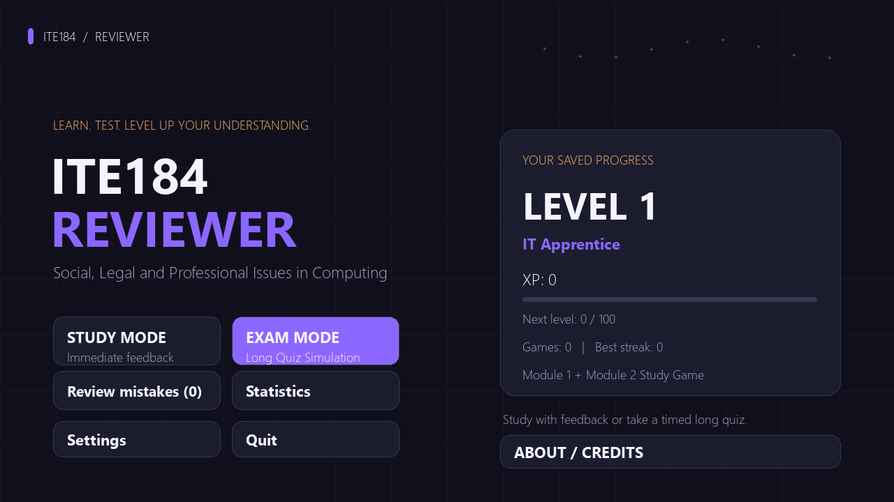
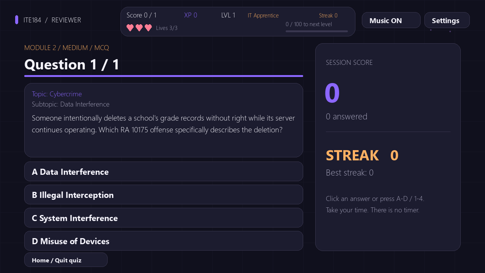
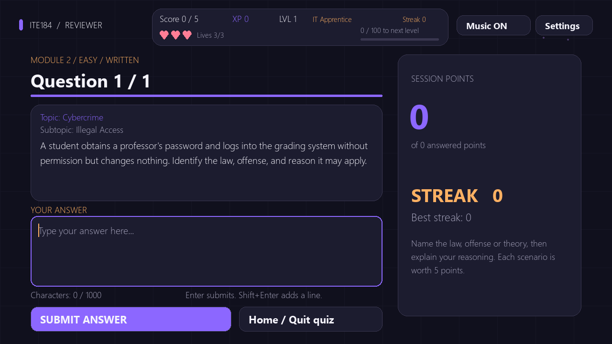
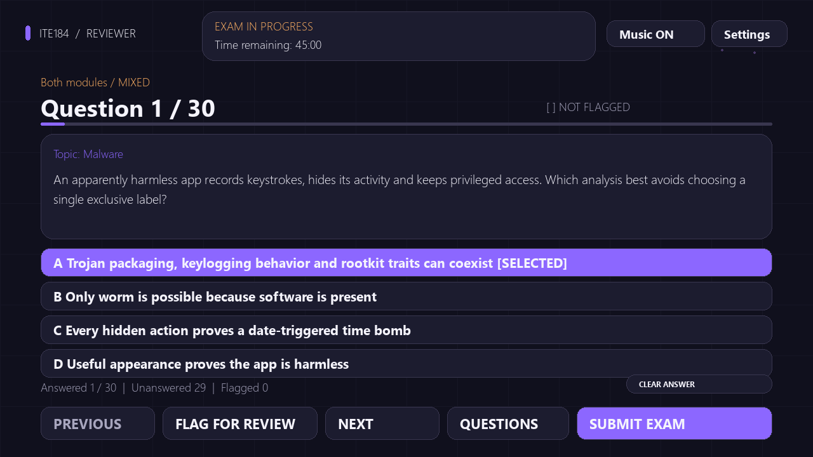
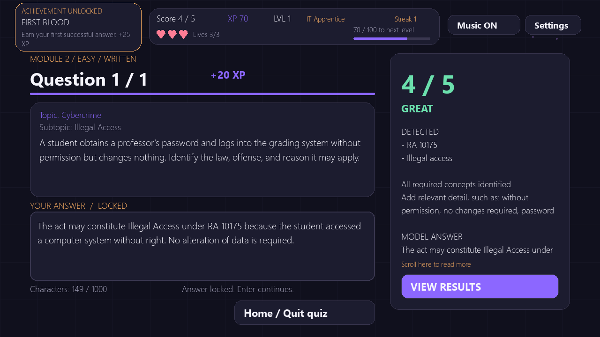
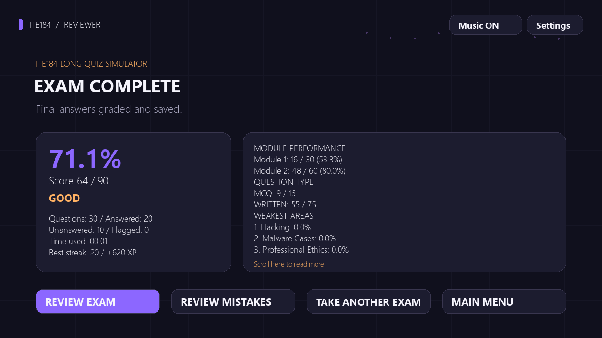

# ITE184 Study Game

An interactive Python/Pygame reviewer for **Social, Legal and Professional
Issues in Computing**, featuring Philippine IT law scenarios, written-answer
keyword grading, learning analytics, and a full exam simulator.

**v1.0.0 · Python 3.10+ · Pygame Community Edition · Offline · MIT**

## Screenshots

Images use an isolated demonstration profile; no personal progress is shown.

| Home | Multiple choice |
| --- | --- |
|  |  |

| Written scenarios | Exam simulator |
| --- | --- |
|  |  |

| Written feedback | Exam results |
| --- | --- |
|  |  |

More images: [Study setup](screenshots/study_mode.png),
[Statistics](screenshots/statistics.png), [Review Mistakes](screenshots/review_mistakes.png),
[Exam setup](screenshots/exam_setup.png), [Exam review](screenshots/exam_review.png),
and [About/Credits](screenshots/about.png).

## Features

- **261 questions:** Module 1, Module 2, or both; Easy, Medium and Hard.
- Multiple-choice, Written Scenario and Mixed study modes.
- Offline keyword-group grading, partial credit and explanations.
- XP, levels, ranks, achievements, streaks and hearts in Study Mode.
- Persistent statistics, topic performance, weak areas and Review Mistakes.
- Music and sound effects generated programmatically for this project.
- Exam Mode with an Atty Long Quiz preset, custom exams, optional timers,
  flags, a question navigator, editable answers, deferred grading and review.

## Study Modes

Choose **Study Mode**, module, type, difficulty and question count.

| Mode | What you do |
| --- | --- |
| Multiple choice | Select A–D; see correctness and an explanation immediately. |
| Written | Type the requested law, offense, theory or reasoning; receive 0–5 points and concept feedback. |
| Mixed | Practice both types, balanced when the available pools allow it. |

MCQs are worth one point; written scenarios are worth five. Study responses lock
after grading. Hearts and streaks reset each session; earned XP and graded
attempts remain saved even if you leave before completing a quiz.

## Exam Mode

Answers remain editable until final submission. Previous/Next, flags and the
palette help you review. Correctness, explanations, keywords, XP, hearts,
streaks and correctness sounds stay hidden while answering. Each MCQ's shuffled
choice order stays identical when you revisit it.

**Atty Long Quiz:** both modules, Mixed, Long Quiz Mix, 30 questions, 45 minutes.
With the current bank: 10 Module 1/20 Module 2, 15 MCQ/15 Written, and
6 Easy/12 Medium/12 Hard questions, worth 90 points in total.

Custom exams offer 10/20/30/50/all/custom counts; Easy/Medium/Hard/All/Long Quiz
Mix; and no timer, 15/30/45/60 minutes or custom 1–180 minutes. Long Quiz Mix
targets 20% Easy, 40% Medium and 40% Hard. Shortages redistribute without
duplicate IDs; overlarge count requests require confirmation.

The monotonic timer starts at **Start Exam** and continues through settings,
the palette and focus loss. Expiry submits automatically. Manual submission
confirms unanswered/flagged counts and offers review shortcuts. Unanswered
slots earn zero; abandoning an exam adds no attempts or rewards.

Results show points, percentage, module/type breakdowns, weakest topics, time
used and rewards. Review filters are All, Incorrect/Partial, Flagged and
Unanswered. History retains ten summaries. Unsubmitted exams live in memory;
crash recovery and permanent detailed answer history remain deferred.

## Course Coverage

| Module | MCQ | Written | Total |
| --- | ---: | ---: | ---: |
| Module 1 | 45 | 30 | 75 |
| Module 2 | 110 | 76 | 186 |
| **Total** | **155** | **106** | **261** |

**Module 1:** ethics, law versus ethics, ethical theories, legal maxims and
professional ethics.

**Module 2:** computer-crime types, sexually-related computer crimes, hacking,
unauthorized access, cybercrime offenses, malware, hacker ethics, professional
constraints, data privacy, access-device fraud, computer espionage, hacking
and malware cases, and Philippine IT laws.

Laws include RA 8792, 10175, 10173, 9995, 11313, 11930, historical 9775,
8484, 11449, 8293, 11055, 11934 and 11479. Older/replacement laws remain
distinct and uncertain case attribution stays qualified. Detailed counts and
content boundaries are in [development documentation](docs/DEVELOPMENT.md#phase-8--full-ite184-question-bank).

## Technologies

Python standard-library modules provide scoring, persistence, timing, WAV
generation and tests. **pygame-ce** supplies the desktop window, input,
rendering and audio; it imports as `pygame`. No API keys, accounts, online
grading or network connection are needed to play.

## Installation

Download the project ZIP or clone your repository, then open the folder
containing `requirements.txt`. Windows instructions:

```powershell
py -m venv .venv
.\.venv\Scripts\python.exe -m pip install -r requirements.txt
```

The environment is optional. To install using your selected Python:

```powershell
py -m pip install -r requirements.txt
```

The sole desktop requirement is `pygame-ce>=2.5.8,<3`. Standard-library modules
are not separate dependencies. Use a clean environment rather than installing
both pygame distributions together. Python source is the v1.0 release format;
no Windows executable is included.

## Running the Game

From the project root:

```powershell
py .\ite184_study_game\pygame_main.py
```

Using the environment above:

```powershell
.\.venv\Scripts\python.exe .\ite184_study_game\pygame_main.py
```

`run_game.bat` is an optional shortcut: it prefers `.venv` when present and
otherwise uses the selected `py` interpreter.
The lightweight terminal MCQ/debugging frontend needs no Pygame:

```powershell
py .\ite184_study_game\main.py
```

Other platforms can use `python3 ite184_study_game/pygame_main.py`. A working
desktop display is required for visual play. Fonts use system fallbacks;
missing audio/files/devices are handled safely. First launch automatically
creates `ite184_study_game/data/stats.json`. Screenshots are not runtime assets.

## Controls

| Control | Study Mode | Exam Mode |
| --- | --- | --- |
| Mouse / A–D / 1–4 | Select an MCQ answer | Select or change an MCQ answer |
| Enter in written text | Submit the response | Add a new line |
| Shift+Enter | Add a new line | Add a new line |
| Mouse wheel | Scroll questions, text and feedback | Scroll questions, text, results and review |
| Previous / Next | Continue after feedback or browse review | Navigate without grading |
| Questions / Flag | — | Jump via palette / toggle a review flag |
| Clear Answer | — | Restore unanswered state |
| Escape | Back, close a panel, or confirm leaving | Back, close a panel, or confirm abandonment |

The palette uses A=answered, ?=unanswered, F=flagged and *=current, so states
are identifiable without color alone. Settings toggle music/effects. The
window resizes while preserving the layout. **About/Credits** is on Home.

## Written Answer Scoring

Each required concept is a synonym group: one phrase satisfies that concept.
Normalization handles case, punctuation, spacing and common RA notation.
Optional keywords add detail.

| Matched content | Points |
| --- | ---: |
| All required concepts plus optional detail, or no optional terms are defined | 5 |
| All required concepts without optional detail | 4 |
| At least half of required concepts | 3 |
| Some required concepts, fewer than half | 2 |
| Only optional content | 1 |
| No recognized content / unanswered | 0 |

This is phrase matching, not an AI evaluation of essay meaning. Name the
requested concepts and explain their relevance. Feedback/review shows model
answers, explanations and matched/missed concepts.

## Statistics & Review Mistakes

Version 3 saves track XP, achievements, question history, points, topic/module
performance, Study high scores and separate exam statistics. Old saves migrate
without erasing progress. Writes use atomic replacement; failures keep progress
in memory and show a warning.

Wrong MCQs and written scores 0–3 join Review Mistakes. Correct MCQs and written
scores 4–5 remove an active mistake while retaining history. Weak areas require
at least two attempts and below 70% of possible points. No attempts display N/A.

Exams update progress only after submission. Every submitted slot, including a
blank zero-point slot, counts as one attempt. Exam averages are arithmetic means
of completed percentages. Exam completions/highs are separate from Study
completions/highs. Reset requires confirmation and leaves course content intact.

Git ignores personal saves and recovery files; `data/.gitkeep` preserves the
folder. No personal XP, mistakes or exam history are shipped.

## Testing

```powershell
py -B -m unittest discover -s .\ite184_study_game\tests -v
py -B .\ite184_study_game\question_bank.py
py -B -m ite184_study_game.content_audit
```

Use the environment's `python.exe` instead of `py` when testing there.
`run_tests.bat` is optional. Tests use temporary profiles and dummy video/audio
drivers. Install requirements for UI checks; those skip when Pygame is unavailable.
**340 tests** cover selection, grading, exams, timers, persistence,
migration, review, achievements, content quality and release reliability.
See [release QA](docs/RELEASE_QA.md) for exact results.

Regenerate public screenshots with a temporary demonstration profile:

```powershell
py -B -m ite184_study_game.tools.preview_release
```

## Project Structure

```text
ITE184-Study-Game/
├── ite184_study_game/
│   ├── pygame_main.py / main.py        # Desktop / terminal entry points
│   ├── question_bank.py / questions/  # Stable course content
│   ├── quiz_engine.py / scorer.py     # Study and keyword grading
│   ├── exam_engine.py / exam_session.py
│   ├── progression.py / achievements.py / stats.py / version.py
│   ├── ui/                           # Screens, input and controllers
│   ├── assets/                       # Original WAVs and image placeholder
│   ├── data/.gitkeep                 # Ignored saves created locally
│   ├── tests/                        # Regression and release checks
│   └── tools/                        # Screenshot and QA helpers
├── screenshots/                      # Public release images
├── docs/                             # Development notes and release QA
├── README.md / CHANGELOG.md / LICENSE
├── requirements.txt / .gitignore
└── run_game.bat / run_tests.bat
```

The working import layout is retained. All phase-by-phase learning notes are
preserved in [docs/DEVELOPMENT.md](docs/DEVELOPMENT.md).

## Disclaimer

This project is an educational reviewer, not legal advice. Course content is
designed for study purposes.

## Credits

**Developer: Andrew Daniel C. Corpuz (AD).** Built with Python and Pygame Community
Edition. Audio effects/background tones were generated programmatically for
the project. No third-party music, downloaded illustrations or bundled fonts
are included. Public screenshots are actual release renders with demonstration data.

The [MIT License](LICENSE) covers original project contributions. Third-party
libraries retain their licenses. The release does not claim ownership of external
course sources or third-party material referenced by educational content.

## Version History

See [CHANGELOG.md](CHANGELOG.md) and [release preparation](docs/RELEASE.md) for
repository naming, topics and safe first-commit commands. Recommended name:
**ITE184-Study-Game**.
